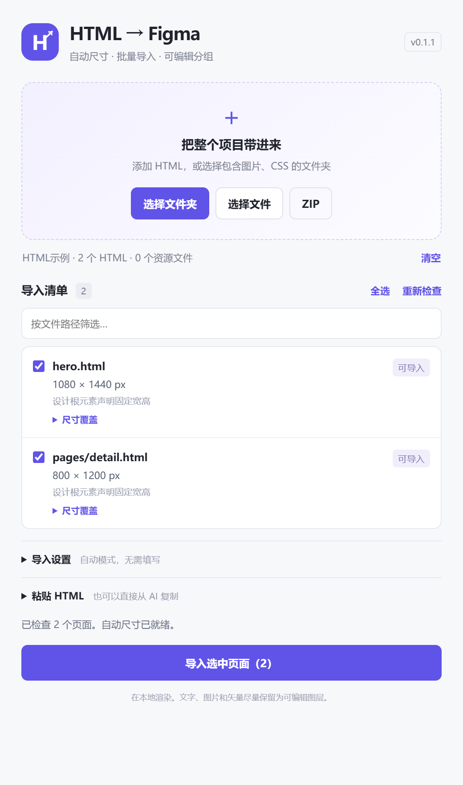

# HTML 自动分组导入 Figma

适合用于 AI 生成的 HTML 文件导入 Figma 进行编辑。

把本地 HTML 项目批量转换为 Figma 图层：自动识别页面尺寸、解析本地图片和样式、保留可编辑文字，并使用 Group 组织结果。



界面预览（使用临时创建的通用 HTML 示例，仅展示自动尺寸与页面勾选，不含用户测试文件）。

当前版本：**0.1.1**。这是开发插件，需要通过 Figma 桌面端安装，尚未发布到 Figma Community。

## 安装

1. 下载 Release 中的安装 ZIP 并解压。也可以下载或克隆本仓库，直接使用仓库根目录中的运行文件。
2. 打开 Figma 桌面客户端中的设计文件。
3. 进入 **Plugins → Development → Import plugin from manifest…**，选择 `manifest.json`。
4. 从 Development 菜单运行 **HTML 自动分组导入**。

`manifest.json`、`code.js` 和 `ui.html` 必须在同一目录。已打包的运行文件无需安装 Node.js。

## 使用

1. 点击“选择文件夹”，选择包含 HTML、图片、CSS 和字体的项目根目录。插件会递归扫描其中的 HTML。
2. 在清单中查看页面尺寸、识别依据和资源检查结果。
3. 勾选需要的页面，点击“导入选中页面”。每个 HTML 生成独立的 Group，结果横向排列。

**手动选择二级页面：**选择包含主页面和子目录的完整项目文件夹，然后取消主页面，勾选子目录中的 HTML。目录结构会被保留用于资源解析。插件只导入勾选的文件，不会自动跟随网页中的导航链接，也不会自动生成 Figma 原型跳转。

也支持选择多个文件、拖入目录、ZIP 和粘贴 HTML。有本地图片或 CSS 时建议选择完整文件夹：单独选择一个 HTML，无法自动访问旁边未选择的资源。

失败页面可单独重试；取消会保留已完成页面并清理正在创建的页面。资源缺失或加载失败会在报告中列出。补齐文件后重新选择项目即可。

## 自动识别尺寸

- 明确的固定尺寸设计区域使用其宽高；可用 `data-figma-root` 指定根元素。
- 固定宽度的长页面按实际内容测量高度，渲染视口高度与导出整页高度分别处理。
- 唯一海报区域中较大的整数比例，例如 `aspect-ratio: 800/1200`，可以作为尺寸线索，界面会标为推测。
- 可选元数据声明渲染视口：`<meta name="html-to-figma-viewport" content="1080x900">`。
- 没有明确设计尺寸的响应式页面使用可记忆的默认 **1440 × 900** 视口，然后测量内容高度。

默认无需填写分辨率。识别不符合预期时，可在设置中覆盖单页尺寸。CSS 中的 1 px 对应 1 Figma 单位，不受显示器缩放影响。

## 图层和资源

- 页面、HTML 结构容器和 SVG 内部容器输出为 Group；完成后检查结果中的 Frame 数量为 0。
- 背景和边框使用矩形，圆角及 `overflow` 裁切使用蒙版；透明边界图层保留页面留白。
- 普通文字保留文本图层，图片使用可替换的图片填充，支持的 SVG 保留矢量。
- 本地资源按完整相对路径解析；CSS 的 `url()` 相对于 CSS 文件解析，避免混用不同目录的同名图片。
- 支持 CSS `@import`、`srcset` / `picture`、常见懒加载属性、字体和本地 SVG 引用。
- 缺失或解码失败的图片会生成占位并报告；网页字体或 Figma 字体不可用时使用替代字体并报告。

页面脚本默认关闭；可信动态页面可主动开启。React / Vue 工程需要先构建为静态 HTML 和资源。转换在本地执行；源文件中的远程资源及主动开启的脚本仍可能发起对应网络请求。

## 开发构建

需要 **Node.js 20+**：

```sh
npm ci
npm run typecheck
npm run build
```

构建会更新根目录中的 `code.js`、`ui.html`，并生成独立安装目录 `dist/`。源码位于 `code.ts` 和 `src/`，`scripts/build.mjs` 负责编译、打包和复制许可证。

本公开仓库仅包含插件源码、构建配置和运行文件，不包含导入用的 HTML 项目、图片、字体或本地验证报告。发布前检查构建产物及 ZIP 内容。

## 当前限制

- Group 不提供 Frame 的 Auto Layout 和响应式约束。分组尺寸偏离捕获范围时，当前页面会清理并报告错误。
- 复杂 `clip-path`、蒙版、倾斜、3D、非均匀缩放和部分复杂渐变会简化或局部栅格化，并报告。
- 远程资源的跨域限制可能阻止读取；字体替代可能改变字形、换行和布局。
- `fixed` / `sticky` 按初始滚动位置导入；跨域 iframe 内容无法转换为可编辑图层。
- 文件夹选择用于一次批量导入，不包含后台持续监听或双向同步。
- 大页面受内存和节点数量限制；单页超过 50,000 个捕获元素时会拒绝导入，建议拆分。

## 许可与来源

基于 Kevin Bryan 的 [Open HTML to Figma](https://github.com/kevicebryan/open-htmltofigma) 二次开发，保留 MIT 许可证。来源及第三方依赖见 `LICENSE` 和 `THIRD_PARTY_NOTICES.md`。

本项目不是原作者的 Community 插件，也不是 Figma 官方插件。
